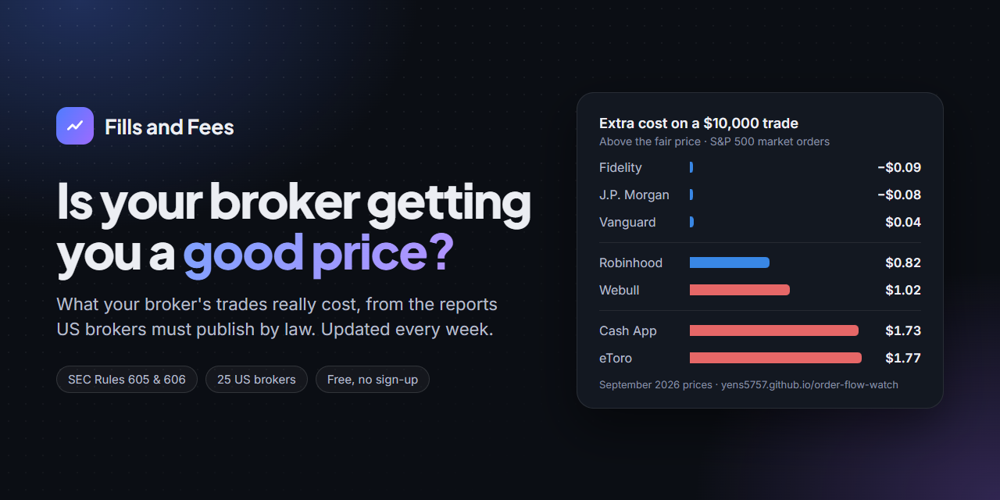
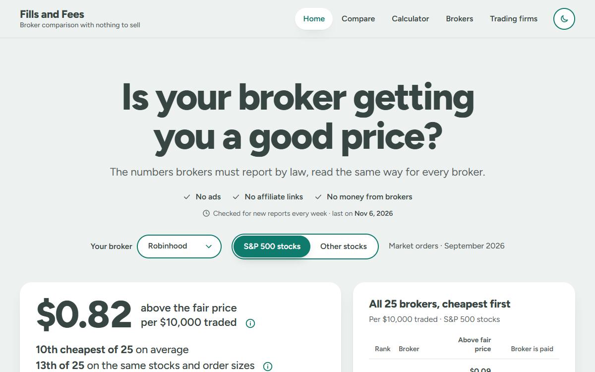
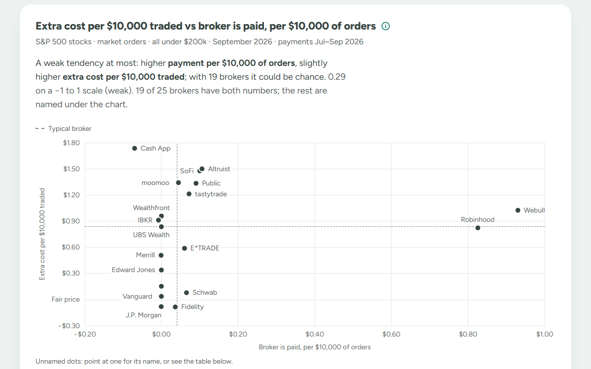

# Payment for Order Flow vs Retail Execution Quality

[](https://fillsandfees.com/)

**Do retail brokers that are paid more for routing customer orders give their customers worse fills?**

An automated pipeline that joins two SEC disclosures, refreshed weekly and published as a website, **Fills and Fees**
(what your broker's trades really cost; the repository keeps its original name, `order-flow-watch`, for now):

- **Rule 606**: which market makers each broker sends orders to, and how much it is paid.
- **Rule 605**: how good the resulting fills were. Since August 2026 the amended rule requires
  large brokers to publish these reports too, which makes a broker-by-broker comparison possible.

**Website:** [Fills and Fees](https://fillsandfees.com/) at fillsandfees.com (the old yens5757.github.io/order-flow-watch address redirects). Two layers:
a plain-language home page (what a $10,000 trade costs at each broker, pick-your-broker report card) for
non-experts, and an explorer where you choose the measure, compare two, filter, sort and share the view.
The menu is Home, Compare (`compare/`), Calculator (`calculator/`), Brokers (`brokers/`, the explorer) and
Trading firms (`trading-firms/`, the market makers); a "How we measure" page (`how-we-measure/`) is linked from the
footer and from the calculator and compare pages, and `firms/` lists every Rule 605 reporter. Every page has its
own URL (paths relative to the site root; old `#/...` links redirect to them):

- **Compare** (`compare/`, opens as Robinhood vs Fidelity; any pair at `compare/<a>-vs-<b>/` with the two broker
  slugs in alphabetical order, e.g. `compare/fidelity-vs-robinhood/`, the other order redirects): two brokers side
  by side on fills, fees and what they are paid for the order flow.
- **Calculator** (`calculator/`): the annual-cost estimator. Enter how you trade (trades per year, typical order
  size, share in S&P 500 stocks, options contracts, idle cash, margin borrowed) and it ranks every broker by what
  that would cost you per year, split into spread paid on fills, commissions, options fees, interest lost on idle
  cash and margin interest, and says which parts a broker has no published figure for. A compact version sits
  on the home page.
- **Broker pages** (`brokers/<slug>/`, e.g. `brokers/robinhood/`): the report card plus a fees card (stock
  commission, options fee per contract, margin rate, interest on idle cash, transfer-out fee) and a trust card
  (FINRA BrokerCheck link by CRD, SIPC membership).
- **Execution speed**: average execution time from Rule 605, in milliseconds, as a measure in the explorer
  (`brokers/?m=speed`) next to the fee measures.

Plus market-maker comparisons, every Rule 605 reporter, and the statistics behind each claim. Options trading is
outside Rule 605, so the site compares options fees but not options fills.

| Home: the easy layer | Explore: the interactive layer |
|---|---|
| [](https://fillsandfees.com/) | [](https://fillsandfees.com/brokers/?m=cost10k&vs=pay10k) |

## Findings so far

September 2026 fills (Rule 605), July–September 2026 payments (Rule 606; April–June for Cash App and Public, which had not
filed yet), 25 retail brokers (19 also report payments)
and 8 market makers (Citadel, Virtu, GTS, G1, Jane Street, HRT, Two Sigma, Jump):

- **Payment predicts worse prices mostly through what customers trade.** Rank correlation between the share of
  the spread a broker is paid and the share its customers pay: +0.32 (S&P 500, p = 0.19) and +0.57 (other
  stocks, p = 0.01). Holding the share price customers trade equal, neither is statistically significant
  (+0.22 / +0.41, p = 0.38 / 0.10): the brokers paid most have customers in cheap, wide-spread stocks. The
  other-stocks link weakens but does not vanish, so treat it as unresolved rather than ruled out. An early 8-broker version showed ~0.87;
  that was small-sample luck.
- **Broker differences are real on identical stocks.** Comparing brokers on the same stock × lot size × order
  size (detailed 605 reports): Fidelity's customers pay 15 points of the spread less than peers; Cash App's,
  eToro's, moomoo's and Coinbase's about 45 points more, and Interactive Brokers' 25 points more.
- **Routing doesn't explain it.** A broker's mix of market makers predicts almost none of its same-stock
  gap (−0.06 on S&P 500 stocks). The same market makers fill different brokers' customers at very different prices.
- **Clientele does.** Brokers whose customers make bigger trades get better prices on the same stocks
  (−0.65 / −0.68, p ≤ 0.001).
- **Market makers differ too.** On identical S&P 500 trades Citadel fills 23 points of the spread better than
  the other market makers; Jump's retail desk 32 points worse.
- **Most of the money is in options** (~70% of payments), which Rule 605 doesn't cover. Payments to the
  tracked brokers grew from $0.6B (2024Q2) to $1.5B a quarter (2026Q2 and Q3).

## Conclusion

Brokers that are paid more for their customers' orders don't give measurably worse prices. They look worse at
first only because their customers trade cheap, wide-spread stocks; compared on similarly priced stocks, the link
weakens below statistical significance (for stocks outside the S&P 500 a weaker link may remain). Brokers still differ a lot on identical trades, and the size of their customers' orders explains that
far better than payment does.

This agrees with [Schwarz, Barber, Huang, Jorion & Odean (2025)](https://papers.ssrn.com/abstract=4189239), who
placed 85,000 test trades and reached the same answer. They also found that the disclosure rules of the time
couldn't show this. The broker-level Rule 605 reports required since August 2026 can.

## How it works

```
fetch_s3_605.py ─────┐
fetch_mm_605.py ─────┤                           ┌─> pfof_vs_execution.py, same_stock.py, by_order_size.py
fetch_finra_606.py ──┼─> parse_*.py ─> DuckDB ───┤
fetch_context.py ────┘                           └─> build_site.py ─> web/ (React) ─> GitHub Pages
                     GitHub Actions: every Monday, only new reports are downloaded
```

| Step | Tool |
|---|---|
| Collect | Python, requests, BeautifulSoup |
| Store + analyse | DuckDB (SQL), permutation tests and bootstrap intervals in plain Python (`stats.py`) |
| Present | React + TypeScript + Tailwind (Vite), interactive Apache ECharts (dark by default), every page pre-rendered to static HTML at build time; matplotlib for the README chart |
| Schedule + host | GitHub Actions (weekly) + GitHub Pages |

## Run it locally

```
pip install -r requirements.txt
python fetch_finra_606.py
python fetch_s3_605.py --all-firms --summary-only   # summaries for every firm
python fetch_s3_605.py                              # detailed per-stock reports, tracked firms
python fetch_mm_605.py                              # Virtu + Jane Street (Citadel: download by hand)
python fetch_context.py                             # S&P 500 list, symbols, VIX, FINRA OTC, SEC EDGAR
python parse_605_summary.py
python parse_606.py
python parse_605_detail.py
python pfof_vs_execution.py
python same_stock.py
python build_site.py                                # -> web/public/data/site.json

cd web
npm install
npm run dev                                         # http://localhost:5173
npm run build                                       # dist/: one pre-rendered index.html per page + sitemap.xml
```

Raw reports are downloaded into `data/` and are never committed. The link-preview image (`web/public/og.png`, also
`docs/social-preview.png`) is rendered by `node scripts/og.mjs` in `web/` with `PLAYWRIGHT_CORE` pointing at any
installed `playwright-core` package (it is not a dependency of the site).

## Fees

Fees are not in the SEC reports. `fees.csv` holds them by hand, one row per broker: stock commission, options fee
per contract, margin rate at $25,000, interest on idle cash, full transfer-out fee, CRD and SIPC membership, with
the `source_urls` they came from, a `checked_on` date (2026-11-01; the site shows the latest as "fees checked"),
a `confidence` grade and notes. A blank cell means the figure could not be confirmed on the broker's own pages
(several pricing pages cannot be read by scripts), and the site shows it as missing rather than guessing; `NA`
means the broker has no such product (Stash, Cash App and Wealthfront offer no options), shown as "not offered"; `VAR` means the rate depends on a balance tier, a program or a
separate product (IBKR's tiered cash interest, Merrill's quote-only margin), shown as "varies".
Margin rates are the standard $25,000-tier rate, never a new-account offer or a paid tier.
To update: `python update_fees.py` lists what is still blank and the page to open; `python update_fees.py <ID>` asks
for each cell of that broker's row and stamps `checked_on`; then run `python build_site.py`. Fees change without notice; re-check the file every quarter.

## Deploy (GitHub Pages, weekly refresh)

1. Create an empty repository on GitHub and push this folder to it (`git remote add origin <url>`, `git push -u origin main`).
2. In the repository: **Settings → Pages → Build and deployment → Source: GitHub Actions**.
3. **Actions → Weekly refresh → Run workflow** for the first build. The first run downloads everything
   (~20–30 min); after that it runs every Monday and only downloads new reports.

GitHub Pages on a free account needs a public repository. The code, firm list and derived results are public;
raw reports are not (they stay in the Actions cache).

## Site structure and SEO

Every page has a real URL under the site root: `compare/`, `compare/fidelity-vs-robinhood/`, `calculator/`,
`brokers/`, `brokers/robinhood/`, `trading-firms/`, `firms/`, `how-we-measure/`. `npm run build` pre-renders each
of them to a static `index.html` with its own title, description, canonical link and Open Graph tags, and writes
`sitemap.xml` and `robots.txt`, so search engines and link previews see the full content without running the app;
in a browser the React app then takes over on top of the pre-rendered page. Old `#/...` links and the previous
page names (`explore/`, `market-makers/`, `method/`, `broker/<ID>/`) redirect to the new paths.

The site's public address is set in one place, `.github/workflows/weekly.yml`: `SITE_BASE` (the path the site is
served under, `/order-flow-watch/` on GitHub Pages) and `VITE_SITE_URL` (the full URL used for canonical links,
the sitemap and link previews). To move to a custom domain, change them to `SITE_BASE=/` and
`VITE_SITE_URL=https://<your domain>/`, add a `web/public/CNAME` file containing the domain, point the domain's DNS at
GitHub Pages and enter it under **Settings → Pages → Custom domain**. The repository and its github.io address keep
their names.

## Private data

Two firms block automated downloads of their Rule 605 reports: Citadel (CDRG) and Interactive Brokers (IBBD). They
are downloaded by hand and can still reach the weekly build through a private repository
(`yens5757/order-flow-watch-private`) laid out as the raw folder is:

```
605/cdrg/CDRG<YYYYMM>.csv   605/cdrg/CDRG<YYYYMM>.zip     # summary CSV + detailed report (a zipped .txt is fine)
605/ibbd/IBBD<YYYYMM>.csv   605/ibbd/IBBD<YYYYMM>.zip
```

Add a repository secret `PRIVATE_DATA_TOKEN` (a token that can read that private repository). When it is set, the
workflow checks the private repository out and copies its `605/` folder into `data/raw/605/` before parsing; when
it is not set, the step is skipped and the job runs without those two firms. The files never enter this repository
or the published site.

## Limitations

- **Sample:** 19 brokers report both payments and fills. Correlations, not causes.
- **Timing:** monthly fills are compared with the latest quarterly payments, which can lag by a quarter.
- **Missing payments:** Albert, Avenue, Coinbase, eToro, Stash and WF Advisors Financial Network file no 606
  of their own. SoFi reports only its share of the payment, so its figure is understated. moomoo's own 606
  shows no payment; its routing affiliate Futu Clearing's is used instead.
- **Share-weighting:** Rule 605 averages weight by shares; the same-stock comparison avoids this.
- **Citadel and Interactive Brokers** block automated downloads, so their reports are added by hand into
  `data/raw/605/cdrg/` and `data/raw/605/ibbd/`; the weekly job runs without them unless the private
  repository is set up (see "Private data").
- **Fees** are hand-collected from published schedules (last checked 2026-11-01), not from a regulatory filing,
  and blank where a broker's own pages could not be read.

## Licence

Code, design and text are © 2026 Aiken Lee, all rights reserved: readable here, runnable locally for personal
evaluation, not for redeployment or reuse (see [LICENSE](LICENSE)). The figures are public facts from SEC Rule 605/606
reports and brokers' published fee schedules.

## Related work

Schwarz, Barber, Huang, Jorion & Odean (2025), "The 'Actual Retail Price' of Equity Trades",
*Journal of Finance* 80(5).
