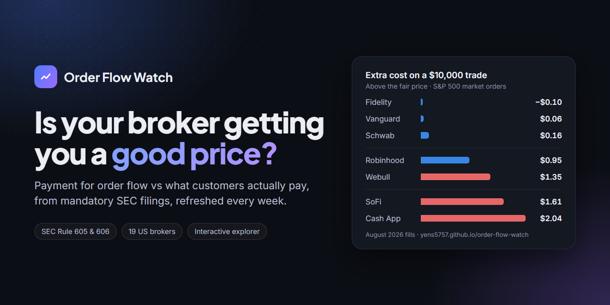
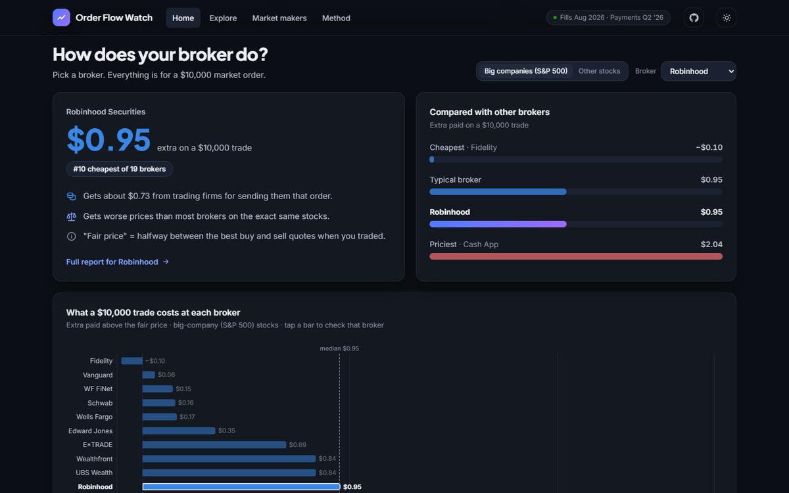
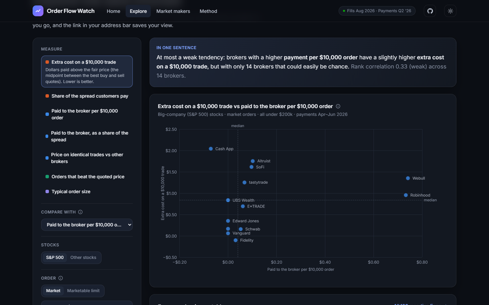

# Payment for Order Flow vs Retail Execution Quality

[](https://yens5757.github.io/order-flow-watch/)

**Do retail brokers that are paid more for routing customer orders give their customers worse fills?**

An automated pipeline that joins two SEC disclosures, refreshed weekly and published as a website:

- **Rule 606**: which market makers each broker sends orders to, and how much it is paid.
- **Rule 605**: how good the resulting fills were. Since August 2026 the amended rule requires
  large brokers to publish these reports too, which makes a broker-by-broker comparison possible.

**Website:** [yens5757.github.io/order-flow-watch](https://yens5757.github.io/order-flow-watch/). Two layers:
a plain-language home page (what a $10,000 trade costs at each broker, pick-your-broker report card) for
non-experts, and an explorer where you choose the measure, compare two, filter, sort and share the view.
Plus a page per broker, market-maker comparisons, every Rule 605 reporter, and the statistics behind each claim.

| Home: the easy layer | Explore: the interactive layer |
|---|---|
| [](https://yens5757.github.io/order-flow-watch/) | [](https://yens5757.github.io/order-flow-watch/#/explore?m=cost10k&vs=pay10k) |

## Findings so far

August 2026 fills (Rule 605), April–June 2026 payments (Rule 606), 24 retail brokers (18 also report payments)
and 8 market makers (Citadel, Virtu, GTS, G1, Jane Street, HRT, Two Sigma, Jump):

- **Payment predicts worse prices only through what customers trade.** Rank correlation between the share of
  the spread a broker is paid and the share its customers pay: +0.30 (S&P 500, p = 0.23) and +0.50 (other
  stocks, p = 0.04). Holding the share price customers trade equal, neither survives (+0.06 / +0.30, p = 0.82 / 0.25):
  the brokers paid most have customers in cheap, wide-spread stocks. An early 8-broker version showed ~0.87;
  that was small-sample luck.
- **Broker differences are real on identical stocks.** Comparing brokers on the same stock × lot size × order
  size (detailed 605 reports): Fidelity's customers pay 16 points of the spread less than peers; Cash App's,
  moomoo's and eToro's about 45 points more.
- **Routing doesn't explain it.** A broker's mix of market makers predicts almost none of its same-stock
  gap (+0.04). The same market makers fill different brokers' customers at very different prices.
- **Clientele does.** Brokers whose customers make bigger trades get better prices on the same stocks
  (−0.67 / −0.69, p ≤ 0.001).
- **Market makers differ too.** On identical S&P 500 trades Citadel fills 20 points of the spread better than
  the other market makers; Jump's retail desk 32 points worse.
- **Most of the money is in options** (~70% of payments), which Rule 605 doesn't cover. Payments to the
  tracked brokers grew from $0.6B to $1.4B a quarter in two years.

Leans towards Schwarz et al. (2025): payment for order flow is not the main driver of execution quality.

## How it works

```
fetch_s3_605.py ─────┐
fetch_mm_605.py ─────┤                           ┌─> pfof_vs_execution.py, same_stock.py, by_order_size.py
fetch_finra_606.py ──┼─> parse_*.py ─> DuckDB ───┤
fetch_context.py ────┘                           └─> build_site.py ─> web/ (React) ─> GitHub Pages
                     GitHub Actions: every Monday, only new reports are downloaded
```

| Step | Tool |
|---|---|
| Collect | Python, requests, BeautifulSoup |
| Store + analyse | DuckDB (SQL), permutation tests and bootstrap intervals in plain Python (`stats.py`) |
| Present | React + TypeScript + Tailwind (Vite), interactive Apache ECharts (dark by default); matplotlib for the README chart |
| Schedule + host | GitHub Actions (weekly) + GitHub Pages |

## Run it locally

```
pip install -r requirements.txt
python fetch_finra_606.py
python fetch_s3_605.py --all-firms --summary-only   # summaries for every firm
python fetch_s3_605.py                              # detailed per-stock reports, tracked firms
python fetch_mm_605.py                              # Virtu + Jane Street (Citadel: download by hand)
python fetch_context.py                             # S&P 500 list, symbols, VIX, FINRA OTC, SEC EDGAR
python parse_605_summary.py
python parse_606.py
python parse_605_detail.py
python pfof_vs_execution.py
python same_stock.py
python build_site.py                                # -> web/public/data/site.json

cd web
npm install
npm run dev                                         # http://localhost:5173
```

Raw reports are downloaded into `data/` and are never committed.

## Deploy (GitHub Pages, weekly refresh)

1. Create an empty repository on GitHub and push this folder to it (`git remote add origin <url>`, `git push -u origin main`).
2. In the repository: **Settings → Pages → Build and deployment → Source: GitHub Actions**.
3. **Actions → Weekly refresh → Run workflow** for the first build. The first run downloads everything
   (~20–30 min); after that it runs every Monday and only downloads new reports.

GitHub Pages on a free account needs a public repository. The code, firm list and derived results are public;
raw reports are not (they stay in the Actions cache).

## Limitations

- **Sample:** 18 brokers report both payments and fills. Correlations, not causes.
- **Timing:** monthly fills are compared with the latest quarterly payments, which can lag by a quarter.
- **Missing payments:** Albert, Avenue, Coinbase, eToro, Stash and WF Advisors Financial Network file no 606
  of their own. SoFi reports only its share of the payment, so its figure is understated. moomoo's own 606
  shows no payment; its routing affiliate Futu Clearing's is used instead.
- **Share-weighting:** Rule 605 averages weight by shares; the same-stock comparison avoids this.
- **Citadel** blocks automated downloads, so its reports must be added by hand into `data/raw/605/cdrg/`;
  the weekly job compares the other market makers without it.

## Related work

Schwarz, Barber, Huang, Jorion & Odean (2025), "The 'Actual Retail Price' of Equity Trades",
*Journal of Finance* 80(5).
